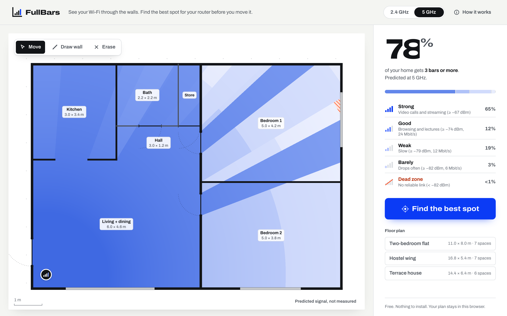

# FullBars

**See your Wi-Fi through the walls. Find the best spot for your router before you move it.**



Most "slow Wi-Fi" is a router in the wrong place. FullBars lets you pick or sketch a floor plan, drop the router on it, and see the **predicted** signal in every room, through every wall, live as you drag. Press **Find the best spot** and it checks a few hundred positions and moves the router to the one that covers the most of your home.

It is a static web app. No account, no server, no API keys. The plan never leaves your browser.

## Run it

Needs Node.js 20 or newer.

```bash
npm install
npm run dev        # http://localhost:5173
npm test           # model and optimiser tests (Vitest)
npm run build      # static site in dist/
npm run preview    # serve dist/ locally
```

No environment variables.

Useful URL options: `?fresh` ignores the plan saved in this browser, `?plan=flat|hostel|terrace` opens a template, `?band=2.4|5` sets the band.

### Deploy to GitHub Pages

The repo includes `.github/workflows/pages.yml`. Push to `main` on GitHub, then in **Settings → Pages** set **Source: GitHub Actions**. The workflow runs the tests, builds, and publishes `dist/`. The build uses relative paths, so it works under `https://<user>.github.io/<repo>/`.

## What it does

- **Plan editor.** Three templates (two-bedroom flat, hostel wing, terrace house). Draw walls (snap to 10 cm, to wall ends, and to horizontal/vertical), pick a material, select a wall to change its material or delete it, erase walls.
- **Live predicted heat map.** Five classes shown as signal bars, from "Strong" to "Dead zone". Drag the router (or use the arrow keys) and the map follows every frame.
- **Probe.** Hover (or tap) anywhere: predicted dBm, bars, distance, and exactly which walls the straight line crosses and what they cost. The crossed walls light up on the plan.
- **Coverage score.** Share of the floor at 3 bars or more, plus the share in each class.
- **Find the best spot.** Coarse-to-fine search over every placeable position (inside a room, 30 cm clear of walls), scored on coverage, then strong coverage, then mean level. The router glides to the winner; the old spot stays marked as "Before", with a before/after card and "Put it back".
- **2.4 / 5 GHz switch** and a **"How it works" sheet** with the formula, the live numbers, editable router power, distance exponent and wall thicknesses, the threshold table, the limits and the sources.

## How the prediction works

For every point, FullBars draws the straight line from the router and computes:

```
received dBm = EIRP − FSPL(1 m, f) − 10·n·log10(d) − Σ loss of each wall the line crosses
```

| Part | Value | Source |
|---|---|---|
| Model form | free-space reference at 1 m, distance term, plus the loss of each wall crossed | COST Action 231 multi-wall model (Motley-Keenan form) |
| FSPL at 1 m | 20·log10(f MHz) − 27.55 dB: 40.2 dB at 2.437 GHz, 46.7 dB at 5.18 GHz | Friis free-space loss |
| Distance exponent n | 3.0 by default (editable) | T. Kang and J. Seo, "Practical Simplified Indoor Multiwall Path-Loss Model", ICCAS 2020: n = 3 fitted from measurements at 2.45 GHz with walls counted separately. With n = 2 (pure free space) a small flat shows 100% coverage everywhere, which does not match common experience. ITU-R P.1238-13 is not used here because its distance coefficients already include wall losses. |
| Router EIRP | 20 dBm by default (editable) | the 2.4 GHz limit in ETSI EN 300 328 |
| Wall loss | computed per band from material properties | ITU-R P.2040-4 (09/2025), Table 3 (a, b, c, d per material) and the single-layer slab transmission coefficient, eqs. (43b), (44), (57)-(59), at normal incidence |
| Bars | 4 ≥ −67, 3 ≥ −74, 2 ≥ −79, 1 ≥ −82, 0 below (dBm) | −67: Cisco Voice over WLAN 4.1 Design Guide, ch. 3 (cell edge for voice/video). −74 / −79 / −82: IEEE Std 802.11 OFDM PHY minimum receiver sensitivity for 24 / 12 / 6 Mbit/s |

Wall losses with the default thicknesses (computed by the app, also checked in the tests against an independent implementation):

| Material | Default | 2.4 GHz | 5 GHz |
|---|---|---|---|
| Concrete | 150 mm | 11.5 dB | 19.3 dB |
| Brick | 115 mm | 3.7 dB | 3.6 dB |
| Plasterboard | 2 × 12.5 mm | 2.2 dB | 2.2 dB |
| Glass | 6 mm | 1.9 dB | 3.3 dB |
| Wood door | 40 mm | 0.6 dB | 1.3 dB |

Cross-check: for 230 mm of concrete, P.2040-4 gives values within 15% of 3GPP TR 38.901 V19.5.0 Table 7.4.3-1 (L = 5 + 4f dB). Kang and Seo measured 17.8 dB per 25 cm cement-mortar wall at 2.45 GHz; P.2040-4 gives about 18 dB for 25 cm of concrete.

### Limits

- Straight lines only: no reflections or diffraction, so signal just past a doorway is often better in reality than shown.
- No furniture, people, appliances or neighbouring networks.
- Every wall is treated as hit head-on; walls crossed at a slant lose more in reality.
- One floor, one router.
- Every number is a **prediction**. FullBars ranks router positions; it does not promise a speed. It has not been calibrated against measured readings yet.

## Tech

- TypeScript, Vite, Vitest. No UI framework.
- The heat map is drawn per pixel by a WebGL2 fragment shader that runs the same model as `src/model/field.ts` (same wall-crossing rules). If WebGL2 is not available it falls back to a 10 cm CPU grid. The coverage numbers always come from the CPU grid.
- Canvas 2D for walls, labels, router and overlays.
- Font: Archivo (SIL Open Font License), bundled through `@fontsource-variable/archivo`.
- Code layout: `src/model/` (geometry, materials, propagation, classes, field, optimise), `src/plans/templates.ts`, `src/ui/` (renderer, GPU heat, panel pieces), `tests/`.

## Video and screenshots

- `assets/demo.mp4`: the Round 1 product video (1:51, 1920×1080, 60 fps). All product footage is real capture of the running app. Built by:
  - `video/record.mjs`: drives the app in Chromium on a stepped clock, so every frame of the app's own animations is captured at 60 fps; each frame is a 2× device-pixel capture of the camera's framing, so the eased zoom-to-focus moves stay sharp;
  - `video/cards.html`: title cards and captions in the app's type;
  - `video/export3d.mjs`: exports the app's own heat layer for the 3D title shot (rendered in Blender);
  - `video/script.mjs` and `video/voice.mjs`: the voice-over lines, read by a local text-to-speech voice;
  - `video/build.mjs`: captions, cross-dissolves, voice placed at the recorded marks, loudness normalised to −16 LUFS, ffmpeg export.
- `assets/*.png`: screenshots of the running build (`tools/check.mjs`, `tools/flow.mjs`).

## Licence

MIT. The template floor plans are illustrative layouts drawn for this project.
